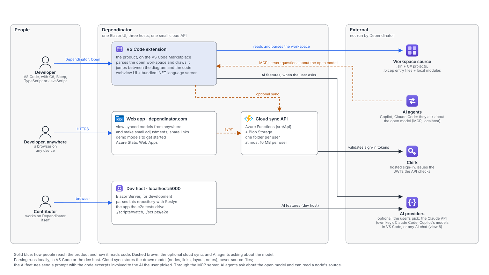
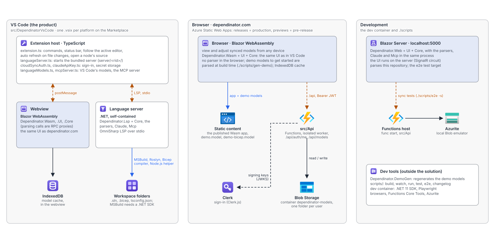
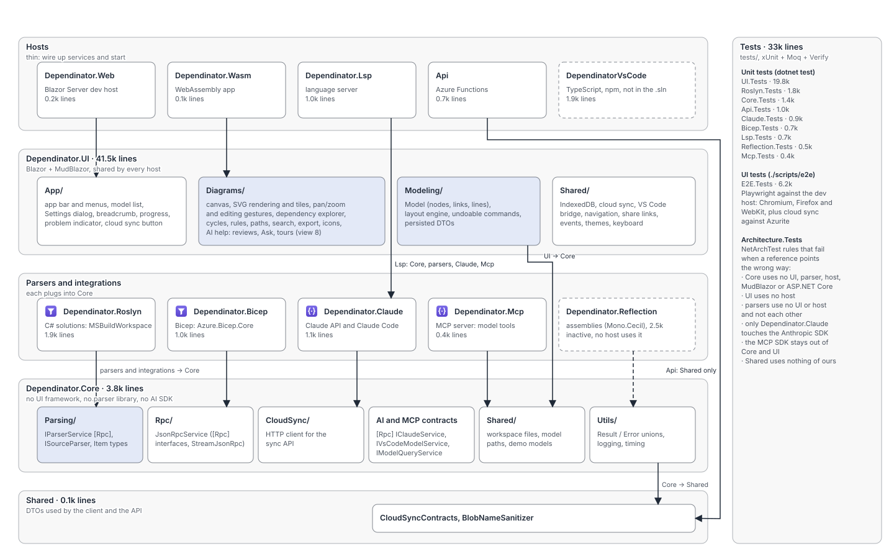
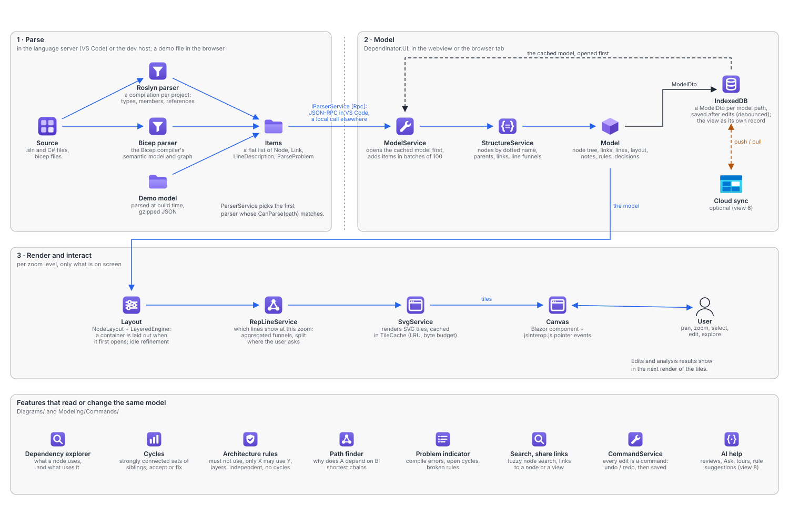
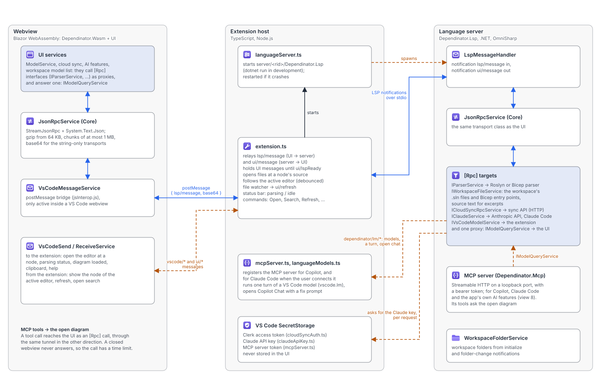
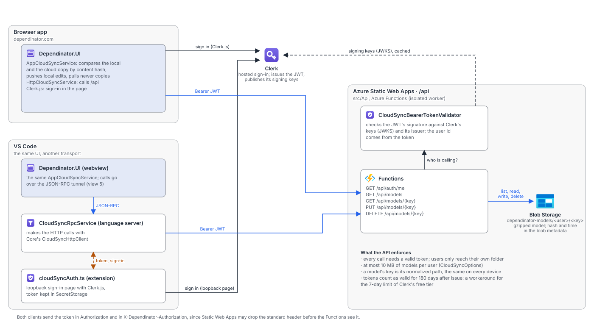
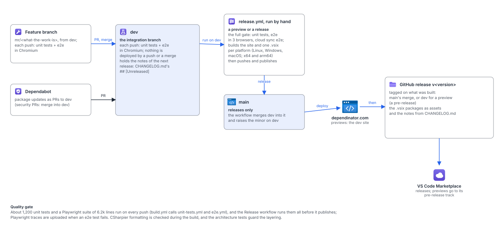
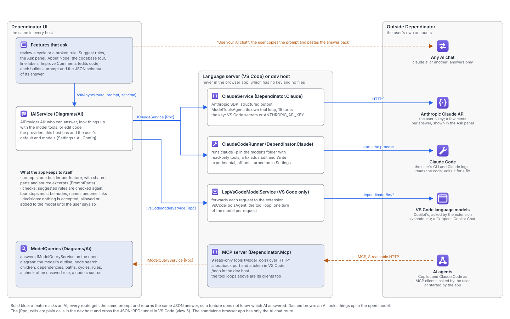

# Dependinator: architecture

An overview of how Dependinator is built, for the people who work on it and the people who plan
it. Eight views, each answering one question: who uses the product, where the code runs, how the code is organized, how
source code becomes a picture, how the VS Code parts talk, how cloud sync and sign-in work, how
a change reaches users, and how the AI features reach an AI. The code is the source of truth; the diagrams are generated from a small
script and are meant to be updated with it (see the end of this page).

## The product at a glance

Dependinator draws a codebase as a zoomable map. A C# solution, an Azure Bicep deployment or a
TypeScript or JavaScript project is parsed into nodes (projects, namespaces, types, members, or
modules and resources, or folders, files and functions) and the links
between them, laid out automatically, and drawn so that zooming in opens a node to show its inside.
Users explore dependencies, find cycles, check architecture rules, jump to the code, and add their
own notes, icons and hand-drawn nodes on top.

| | |
|---|---|
| **Shipped as** | A VS Code extension on the Marketplace (the product), and a web app at [dependinator.com](https://dependinator.com) for viewing synced models from anywhere and making small adjustments (with demo models to get started) |
| **Languages it reads** | C# (`.sln` with C# projects, through Roslyn), Azure Bicep (an entry `.bicep` file and its local modules, through the Bicep compiler), and TypeScript and JavaScript (a `tsconfig.json`, `jsconfig.json` or `package.json` project, through the TypeScript compiler in a Node.js helper process) |
| **Stack** | .NET 10 (built with the .NET 11 SDK for C# 15 unions), Blazor WebAssembly and Blazor Server, MudBlazor, StreamJsonRpc, OmniSharp LSP, TypeScript for the extension, Azure Static Web Apps, Azure Functions and Blob Storage, Clerk for sign-in, the Anthropic and Model Context Protocol C# SDKs for the AI features |
| **Size** | About 58k lines of product code, three quarters of it in the shared UI library; about 34k lines of tests |
| **Tests** | About 1,270 unit tests, a Playwright UI suite run in Chromium, Firefox and WebKit, and architecture tests that guard the layering |
| **Releases** | Version 0.91 (beta), about 40 releases since July 2026. Previews and releases are made by hand with the Release workflow (`docs/RELEASING.md`) |

## 1. Context view: who uses Dependinator, and what it talks to

There are three ways in. **Developers** install the VS Code extension, open a folder with a `.sln`
or a Bicep deployment, and run *Dependinator: Open*; this is the product. **The same users, away
from VS Code**, open dependinator.com in a browser on any device to view the models they synced
from VS Code and make small adjustments, such as notes, layout or a hand-drawn design model. Until
there are synced models, the built-in demo models (this repository and the webshop Bicep example)
let a new user get started without installing anything. **Contributors** run the Blazor Server dev host, which parses
this repository and is also the app the e2e tests drive.

Only three external services are involved, and all are optional for the core use: **Clerk** signs
users in for cloud sync, the small **cloud sync API** (our own Azure Functions over Blob Storage)
stores the synced models, and the **Anthropic Claude API** answers the AI features when the user
asks (reviewing a cycle or a dependency that breaks a rule, suggesting rules and line labels, a
guided tour of the codebase, questions about a node or the model), with the user's own API key. Claude is called from the VS Code extension's language
server and from the dev host, never from the browser app. The same features can instead run the
user's local **Claude Code** (experimental), in VS Code a model VS Code offers to extensions
(**Copilot**'s by default, through its Language Model API, asked by the extension for the language
server, with fixes handed to Copilot Chat's agent mode), or go through any AI chat by copy and
paste; the user picks the default in Settings › AI (view 8). The other way round, AI agents (Copilot or
Claude Code) can ask Dependinator about the open model through its **MCP server** on localhost.

Points to discuss: source code never leaves the machine through sync, only the drawn model does,
but the AI features send code excerpts of what they ask about, and Ask about the model can read a
node's source on request. Claude Code and Copilot can also change the code (a fix, a proposed
change, better comments), only when the user presses the button for it. The web app cannot parse
code: what it shows comes from VS Code through sync, or from the demo models.

## 2. Hosts view: one UI, three hosts

The whole user interface is one Razor class library, `Dependinator.UI`, and it runs unchanged in
three hosts.

In **VS Code** the TypeScript extension opens a webview that loads the **Blazor WebAssembly** build
(`Dependinator.Wasm`), and starts a **language server** (`Dependinator.Lsp`), a self-contained .NET
executable bundled per platform, which hosts the parsers. The UI cannot read files or run Roslyn
inside a webview, so it calls the parser through an RPC proxy and the call is carried to the
server (view 5). Models are cached in the webview's IndexedDB.

On **dependinator.com** the same WebAssembly build is served by Azure Static Web Apps, mainly to
view and adjust synced models from any device. The site's `/api` routes go to `src/Api`, the
Functions app for cloud sync. There is no parser in the browser: the two demo models that help a
new user get started were parsed at build time by `Dependinator.DemoGen` and are downloaded as
gzipped files. A release deploys production and a preview a pre-release site.

The **Blazor Server** host (`Dependinator.Web`) runs the UI on the server and the parsers in the
same process, so a contributor gets hot reload and real parsing of this repository with one
command (`./scripts/watch`). With `./scripts/e2e -s` a local Functions host and Azurite stand in
for the cloud.

Points to discuss: the browser and VS Code builds are the same binary, which keeps behavior aligned
but means UI work is always tested in WebAssembly, the slowest of the three (layout budgets are
measured there). Parsing C# needs an installed .NET SDK on the user's machine, because Roslyn loads
projects with the SDK's MSBuild; Bicep needs nothing installed, and TypeScript and JavaScript are
parsed on the Node.js runtime VS Code itself runs on (the dev host needs `node` on the PATH).

## 3. Code structure view: projects, layers and the rules that guard them

References point one way: **hosts → UI → Core → Shared**, with the parser libraries (**Roslyn**,
**Bicep**, **TypeScript**) and the **Claude** and **Mcp** integrations plugging into Core. Hosts are thin (the two Blazor hosts
a couple of hundred lines each, the language server about a thousand): they register services and start. `Dependinator.Core` is host-agnostic: the parsing
contracts (`IParserService`, `ISourceParser`, the `Item` types), the JSON-RPC transport, the cloud
sync HTTP client, workspace and model-path services, the `[Rpc]` contracts of the AI features and
the MCP server (`IClaudeService`, `IVsCodeModelService`, `IModelQueryService`), and the
`Result`/`Error` types every fallible call returns. `Shared` holds the few DTOs that the API and the client both use.

`Dependinator.UI` is where most of the product lives (about 41k lines, 27k of them in `Diagrams/`): `Modeling/` owns the
in-memory model, the automatic layout and the undoable commands; `Diagrams/` renders and handles
interaction, and holds the analysis features, one folder (and namespace) each: the canvas and view
state in its root, `Svg/` and `Tiles/` render, `Lines/` decides which lines show and where they run,
`Interaction/` takes input (pan, zoom, selection) and `Editing/` changes the model, then the
features `Cycles/`, `Rules/`, `Navigation/` (search, paths), `Dependencies/`, `Tooltips/` (hover
cards), `Icons/`, `Export/`, `Tours/`, `Ask/` and `NodeHelp/`, with `Ai/` the plumbing the AI
features share (view 8); `App/` is the shell (app bar, model list, the Settings dialog); `Shared/`
holds the cross-cutting services. Adding a language means adding a library with an `ISourceParser`,
registering it in the Lsp and Web hosts, and adding an architecture rule; little else changes (a
node type and an icon where the language has a new kind of thing, as files and functions were for
TypeScript). A language with its own toolchain keeps it: `Dependinator.TypeScript` is 200 lines of
C# that start a Node.js helper (1.3k lines of TypeScript on the TypeScript compiler API, bundled
into one script and embedded in the dll), which prints the items.

`Dependinator.Architecture.Tests` turns the layering into failing tests (NetArchTest), so a
reference in the wrong direction breaks the build in CI rather than surfacing in a review.

Points to discuss: `Dependinator.UI` is large and growing; `Diagrams/` alone holds rendering,
interaction and the analysis features (in sub-folders since Nov 2026), and could be split into
libraries if it keeps growing.
`Dependinator.Reflection` (2.5k lines, plus tests) is kept but not used by any host.

## 4. Runtime view: from source code to a picture on the screen

**Parse.** `ParserService` hands the model path to the first parser whose `CanParse` matches:
Roslyn opens the solution with `MSBuildWorkspace` and walks each project's compilation; the Bicep
parser compiles the entry file with its local modules and walks the semantic model; the TypeScript
parser starts its Node.js helper, which builds the compiler's program for the project and resolves
every reference to its declaration; the demo paths load a pre-parsed file. Every parser returns the same thing, a flat list of **items**: nodes named
by dotted paths (`Dependinator.Core.Parsing.ParserService`), links between names, optional line
descriptions, and parse problems such as compile errors. This list is the only contract between
parsing and the rest, and the call is an `[Rpc]` interface, so it crosses a process boundary in VS
Code and is a plain call elsewhere.

**Model.** `ModelService` first opens the cached model, so a known model appears instantly, then
parses and merges the items in batches of 100. `StructureService` builds the node tree from the
names, adds links and the line "funnels" that aggregate many links into one line between siblings,
and removes what a new parse no longer reports. The model, with the user's layout, notes, dimmed and
hidden nodes, rules and the decisions on cycles and on dependencies that break a rule, is saved as
a `ModelDto` to IndexedDB shortly after each change, and optionally synced. Where the user is
looking (pan and zoom) is saved apart as a small view record, so moving around never rewrites the
model. Preferences that are not about one model (theme, line style, the AI provider) are in
`Config`, set in the Settings dialog.

**Render.** Nothing is laid out up front. A container is laid out (layered, few crossings) the
first time it opens on screen, and large containers are refined in the background when the user is
idle. `RepLineService` decides which lines exist at the current zoom, `SvgService` renders the
visible area as SVG tiles that are cached, and the `Canvas` component shows them and turns pointer
events into gestures. What a node shows at a zoom level is decided in one place, `NodeViewPolicy`:
an icon, an open container, or for a type a card that lists its members like a class box. This lazy, tiled design is what keeps large solutions responsive in
WebAssembly.

The features that make the map useful read the same model: the dependency explorer, cycle
detection (strongly connected components among siblings, with "accept" or "fix later"),
architecture rules of several kinds (must not use, only X may use Y, layers, independent,
independent parts, no cycles inside; a violation can be allowed or marked "fix later"), the path finder ("why does A
depend on B?"), the problem indicator, dimmed and hidden nodes, hover cards, search and share
links. The AI features (view 8) read it through the same services. Every edit goes through `CommandService`, so it can be undone, and is saved.

Points to discuss: the cache-first load means a model can show a stale state for the seconds a
re-parse takes; the problem indicator reports when that parse finds compile errors. All model
state is guarded by one lock per session, which keeps rendering and parsing consistent but is a
known place to look first for UI stalls.

## 5. VS Code integration view: how the webview, the extension and the server talk

The UI and the language server talk **JSON-RPC end to end**, with the extension host only relaying
strings. In the webview, a UI service calls an `[Rpc]` interface such as `IParserService`;
`JsonRpcService` (StreamJsonRpc) serializes the call, gzips payloads from 64 KB, splits messages
into chunks of at most 1 MB and base64-encodes them; the webview posts them to the extension as
`lsp/message`, the extension forwards them as LSP notifications over stdio, and the server's own
`JsonRpcService` dispatches them to the real implementation. Answers travel back as `ui/message`.
The extension holds messages until the server reports `ui/lspReady`, and restarts a crashed server.

Next to the tunnel there are a few plain messages between the UI and the extension: open the
editor at a node's source, show the node for the file the user switched to, refresh after source
files changed, open search, report parsing status for the status bar. Secrets stay in the
extension: the Clerk token, the Claude key and the MCP server's token live in VS Code's secret
storage. The server asks for the Claude key per request; the two tokens are handed over when it
starts, the Clerk token again whenever it changes. The server also asks the extension for
what only VS Code can do: a turn of a VS Code language model (Copilot's) and opening Copilot Chat
with a prompt (`languageModels.ts`).

The language server also runs the **MCP server** (`Dependinator.Mcp`, Streamable HTTP on a
loopback port, a bearer token from the extension's secret storage). Its tools ask the open diagram
through the same tunnel, in the other direction: `IModelQueryService` is an `[Rpc]` interface the
UI implements, so the answers come from the model the user sees, with its layout, cycles and
rules. The extension registers the server with VS Code for Copilot and, with *Dependinator: Connect
Claude Code*, with Claude Code for the folder. While the diagram is closed the tools answer with an
error that asks to open it. The dev host serves the same tools at `/mcp`, without a token. The
app's own AI features use them too: Suggest rules, the codebase tour and Ask about the model pass the server to
`claude -p`, so Claude Code can check a rule or look things up on the model, and Ask's API key route
(`ModelToolsAgent` in `Dependinator.Claude`) and the Copilot route (`VsCodeToolsAgent` in the
language server) run their own tool-use loops as MCP clients of the same server, so the tools are
defined once (view 8). Each query reports itself to the UI scope it asks
(`IModelQueries.Asked`), which the Ask panel shows as lookup lines.

Points to discuss: the same `[Rpc]` interface works in process (dev host, browser) and across the
tunnel, which keeps one code path, but anything a parser reads from statics or configuration does
nothing in VS Code; per-model settings must travel as method arguments. The web-only flavor of the
extension (vscode.dev) cannot start the server and therefore cannot parse.

## 6. Cloud sync and identity view

Sync is optional and per user. Users sign in with **Clerk**: in the browser app with Clerk.js on the
page; in VS Code through a sign-in page the extension serves on a loopback port, after which it
keeps the token in secret storage. `AppCloudSyncService` in the UI compares the local and the cloud
copy of the open model by content hash, pushes local edits and pulls newer copies, in the
background while the user works. In the browser it calls `/api` directly; in VS Code the call goes
through the tunnel to the language server, which makes the HTTP request with the stored token.

The **API** is five small Functions. Each request's JWT is validated against Clerk's published
signing keys and issuer, and the user id in the token decides the folder in Blob Storage the call
can touch. Models are stored gzipped, with their hash and update time as blob metadata, at most
10 MB per user. A model's key is its normalized path, so the same model has the same key on every
device; share links use that key.

Points to discuss: tokens are accepted for 180 days after they were issued instead of until their
own expiry, a workaround for the 7-day limit of Clerk's free tier that should go once a paid plan
allows longer lifetimes. Both clients send the token in a custom header as well as in
`Authorization`, because Static Web Apps may drop the standard header.

## 7. Delivery view: from a commit to production and the Marketplace

Work happens on `mr/...` feature branches from `dev`, merged through pull requests; each push runs
the unit tests and the e2e suite in Chromium, and each pull request gets its own test site. `dev`
is the integration branch. Dependabot sends package updates to `dev`. Nothing is deployed by a push
or a merge. Two small workflows sit beside this: `branch-graph.yml` publishes a graph of the
branches on GitHub Pages, and `issue-triage.yml` starts a Claude triage task when an issue opens.

Previews and releases are made by hand with the Release workflow (`docs/RELEASING.md`), from the
notes written in `CHANGELOG.md`. Both run the full gate (unit tests, e2e in Chromium, Firefox and
WebKit, and the cloud sync e2e tests against Azurite and a local Functions host) and build the web
app and one `.vsix` per platform (Linux, Windows and macOS, each for x64 and arm64, each with its
own self-contained server). A preview builds `dev` and deploys the pre-release site, the
Marketplace's pre-release track (which users opt into per extension) and a GitHub pre-release. A
release merges `dev` into `main`, raises the minor version on `dev`, and only then
pushes both, deploys dependinator.com, and publishes the VS Code Marketplace and a GitHub release.

Points to discuss: the full gate runs only when a preview or a release is made, so a `dev` that
fails in Firefox, WebKit or cloud sync is found then rather than at the merge. The demo models and the demo gif are generated from the code and checked in,
so they need regenerating when the parser or the UI changes visibly.

## 8. AI features view: how a feature asks an AI, and how an AI asks about the model

The AI features are optional help on top of the map: a second opinion on a cycle or on a
dependency that breaks a rule, suggested rules and line labels, a guided tour, better comments, and
the Ask panel for questions about the model or the selected nodes. They share one design, in
`Diagrams/Ai/`.

**A feature asks.** Each feature builds a prompt (the model's facts, with source excerpts where
they help) and the JSON schema of the answer it wants, and gives both to `IAiService` with the
route to take. `AiProvider.All` lists the providers once, with what each can do: answer, look
things up with the model tools, edit code. The user picks a default and the models in Settings ›
AI, and every place that asks shows the same button and provider menu. Because every route gets
the same prompt and returns the same JSON, a feature does not know which AI answered, and a new
provider is one more entry and one more route.

**Four routes.** *Claude* with the user's API key and *Claude Code* (the user's own CLI and login,
experimental and off until turned on) are both behind Core's `[Rpc] IClaudeService`, implemented by
`Dependinator.Claude` in the language server or the dev host. *Copilot* is behind
`[Rpc] IVsCodeModelService`: the language server forwards each request to the extension, which
asks a model VS Code offers. The *AI chat* route needs nothing: the user copies the prompt and
pastes the answer back. The UI never calls an AI itself, so the standalone browser app, which has
no key and no source files, offers only the AI chat.

**An AI asks back.** The Ask panel, Suggest rules and the tour are better with more than one
prompt can hold, so the AI looks things up while it answers, with the nine read-only tools of the
MCP server (the model's outline, node search, a node's children and dependencies, paths, cycles,
rules, a check of a rule that is not saved, a node's source). The tools are defined once, in `Dependinator.Mcp`, and reach the open
diagram through `[Rpc] IModelQueryService`, which the UI's `ModelQueries` answers. Claude Code is
started with the server in its MCP configuration; the Copilot route and, for the Ask panel, the
API key route run their own tool loops (`VsCodeToolsAgent`, `ModelToolsAgent`) as clients of the
same server. Suggest rules and the tour on the API key route answer from the prompt alone.
Outside agents use the same tools: Copilot, or Claude Code in a terminal (view 5).

**Changing code** is a separate, explicit step. "Fix with", "Do it with" and "Improve with" run
Claude Code in the model's folder with edit tools but no command tools, with a warning first when
git shows uncommitted changes, or hand the prompt to Copilot Chat's agent mode with its own
Keep/Undo review. The model is re-parsed afterwards, in VS Code by the file watcher.

Dependinator does not take an answer on trust where it can check: suggested rules are checked
again against the model, tour stops that are not nodes are dropped, node names in an answer become
links, and nothing is accepted, allowed or added until the user decides.

Points to discuss: answers cost the user money or plan quota, and only the API key route can say
how much; the prices and the default models are a hand-kept list (`ClaudeModels`) that needs an
update when Anthropic releases a model. Whether a third-party tool may use a Claude subscription
through Claude Code is unclear, which is why that route is opt-in. The Copilot route cannot be
tried in CI or a cloud session, since it needs a signed-in VS Code. `./scripts/ask-eval` scores the
Ask panel's answers on a set of questions and should be run after a prompt or tool change.

## Key design decisions

| Decision | Why | What it costs |
|---|---|---|
| One Blazor UI for every host | One implementation of a large, interactive UI for VS Code, the web and development | WebAssembly sets the performance budget for everything |
| Parsers behind an `[Rpc]` interface | The parser runs where the files and the SDK are (the language server), the UI stays the same | Settings must travel as arguments; calls can fail like network calls |
| A flat item list as the parser contract | New languages (Bicep was added in one release) only produce items; layout, rendering and analysis come for free. The list is plain JSON, so a parser can be a program in another language (TypeScript's runs on Node.js) | Language-specific meaning has to fit nodes, links and a few properties |
| Lazy layout and tiled SVG rendering | Large solutions stay responsive; only what is on screen is computed | More moving parts: layout versions, refinement, tile cache budgets |
| Local-first models with optional sync | Works offline and without an account; nothing leaves the machine by default | Two copies to reconcile when sync is on |
| `Result` / `Error` unions instead of exceptions | Failures are visible in signatures and must be handled (the build fails on a missing case) | Builds with the .NET 11 SDK while the target stays net10.0 |
| Architecture rules as tests | The layering stays true without relying on review | A new project needs a new rule |
| AI behind `[Rpc]` interfaces, with the user's own provider | No AI cost or key on our side; the UI, which also ships to the browser, holds no SDK and no secret | Four routes to keep working; CI tests them against stand-ins, the real services are tried by hand |
| One MCP server for every AI that looks things up | The model tools are defined once, for outside agents and for the app's own features | The diagram must be open; in VS Code each tool call crosses the tunnel |

## Where to start reading the code

| To understand | Start at |
|---|---|
| How a model is loaded, parsed and saved | `src/Dependinator.UI/Modeling/ModelService.cs` |
| What parsers return | `src/Dependinator.Core/Parsing/Types.cs`, `ParserService.cs` |
| C# parsing | `src/Dependinator.Roslyn/Parsing/SourceParser.cs` |
| Bicep parsing | `src/Dependinator.Bicep/Parsing/BicepParser.cs`, `ModelBuilder.cs`, and [docs/notes/BICEP-PARSER.md](notes/BICEP-PARSER.md) |
| TypeScript and JavaScript parsing | `src/Dependinator.TypeScript/Helper/src/model.ts` (the helper), `Parsing/TypeScriptParser.cs` (runs it), and [docs/notes/TYPESCRIPT-PARSER.md](notes/TYPESCRIPT-PARSER.md) |
| The in-memory model | `src/Dependinator.UI/Modeling/Models/Model.cs`, `Node.cs` |
| Rendering and zoom | `src/Dependinator.UI/Diagrams/`: `Svg/SvgService.cs` (tile cache), `Svg/NodeTreeSvg.cs` (drawing), `Lines/RepLineService.cs`, `NodeViewPolicy.cs` |
| Layout | `src/Dependinator.UI/Modeling/NodeLayout.cs`, `Layout/LayeredEngine.cs` |
| The VS Code bridge | `src/DependinatorVsCode/src/extension.ts`, `src/Dependinator.Lsp/LspMessageHandler.cs`, `src/Dependinator.Core/Rpc/` |
| Cloud sync | `src/Dependinator.UI/Shared/CloudSync/AppCloudSyncService.cs`, `src/Api/ModelFunctions.cs` |
| Cycles and rules | `src/Dependinator.UI/Diagrams/Cycles/CycleService.cs`, `Rules/RuleService.cs` |
| The AI features | `src/Dependinator.UI/Diagrams/Ai/AiProvider.cs`, `AiService.cs`, `AiOpinion.razor`; `Diagrams/Ask/AskModel.cs`; `src/Dependinator.Claude/ClaudeService.cs` |
| The MCP server and model tools | `src/Dependinator.Mcp/ModelTools.cs`, `src/Dependinator.UI/Diagrams/Ai/ModelQueries.cs`, `src/DependinatorVsCode/src/mcpServer.ts` |
| Settings | `src/Dependinator.UI/App/SettingsDialog.razor`, `Shared/ConfigService.cs` |
| Hosts and service wiring | each host's `Program.cs` |
| Conventions, commands and traps | [CLAUDE.md](../CLAUDE.md), [CONTRIBUTING.md](../CONTRIBUTING.md), `.claude/rules/` |

## Risks and open topics

- **SDK ahead of the target framework.** The build needs the .NET 11 SDK for C# 15 unions while the
  projects target net10.0 (LTS); the later move to net11.0 waits for Azure Static Web Apps, see
  [docs/notes/NET11-UPGRADE.md](notes/NET11-UPGRADE.md).
- **C# parsing needs a .NET SDK on the user's machine** (Bicep does not). A user without one gets
  a clear error, but it is a step to install before the first map.
- **A second toolchain in the build.** The TypeScript parser's helper is built with npm, so a
  solution build needs Node.js, and its packages (the TypeScript compiler, esbuild) are bumped by
  hand: Dependabot and the nightly package task only look at NuGet.
- **Clerk free tier.** The 180-day token workaround (view 6) trades some security for convenience.
- **Concentration in one library.** Three quarters of the product code is in `Dependinator.UI`,
  which grew by almost half in the three weeks the AI features were added.
- **AI routes outside our control.** The Claude Code route depends on a policy that is not settled,
  and the Copilot route on a VS Code API we can only try by hand (view 8).
- **Inactive code.** `Dependinator.Reflection` is maintained but unused.
- **Known parser gaps** are listed in `.claude/rules/parsing.md` (for example, generic type
  arguments do not produce links yet).

## Regenerating the diagrams

The SVGs are generated by [architecture/generate.py](architecture/generate.py), the same approach
as the [webshop example's diagrams](../examples/bicep/ARCHITECTURE.md): icons from Dependinator's own
icon library (`src/Dependinator.UI/Diagrams/Icons/Library`), cards, groups and labeled edges placed
by hand, so they stay consistent and can be edited as text. Run it with Python 3 after changing the
architecture, and check the result in a browser; the files render standalone and inside this page.

The sizes in this page and in the diagrams are lines of C# and Razor per project (TypeScript for
the extension), and the unit test count is the `[Fact]` and `[Theory]` attributes outside the e2e
project. They, the version and the diagrams are what goes stale first: feature work tends to
update the text and leave `generate.py` alone.
