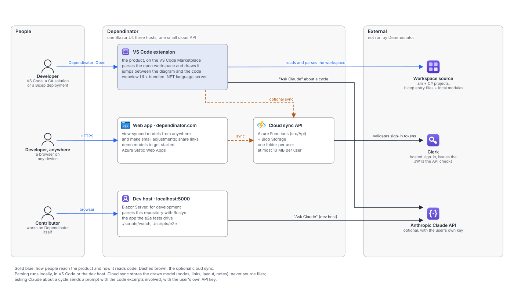
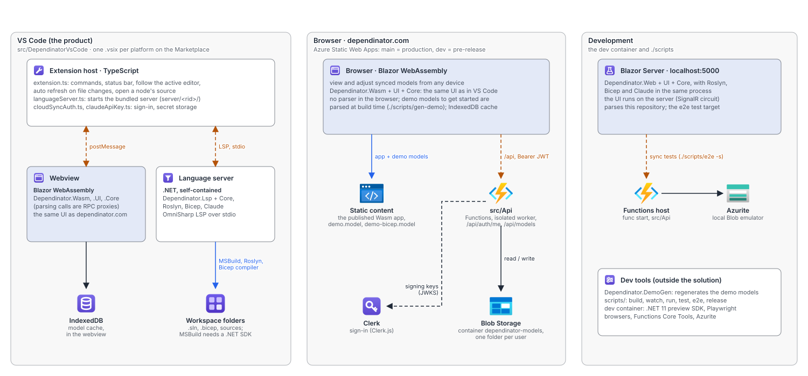
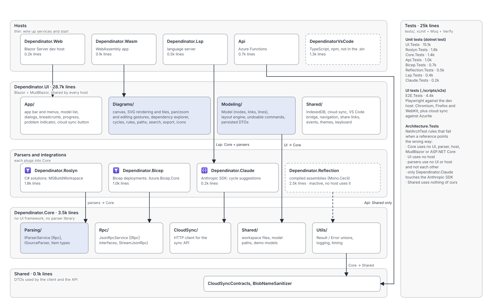
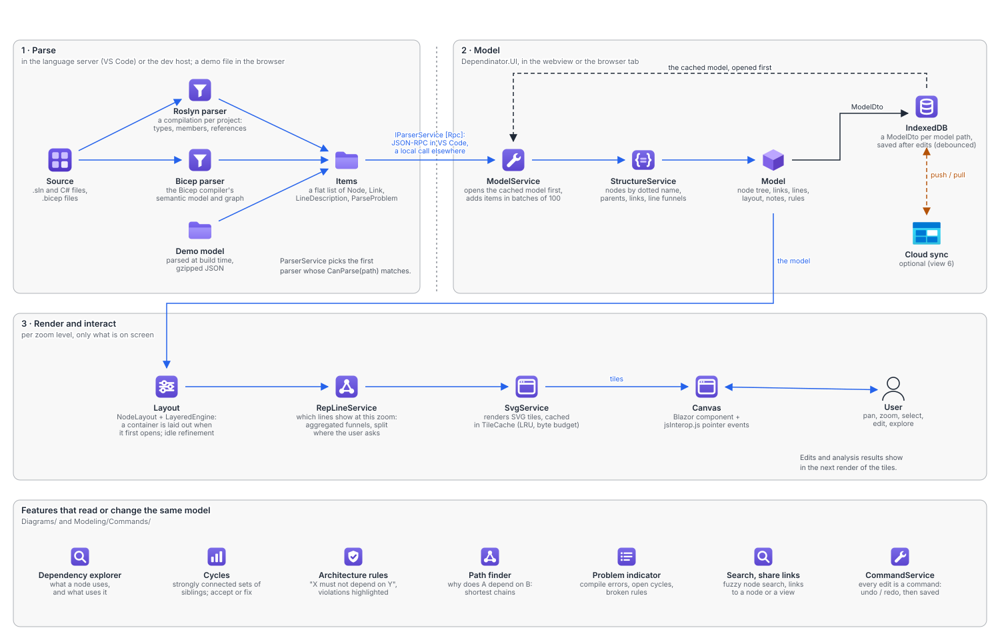
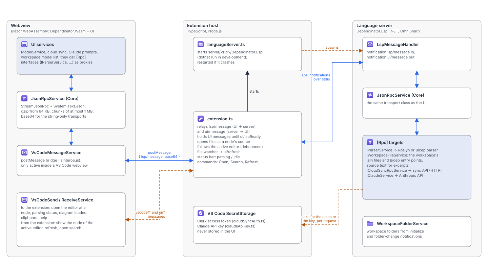
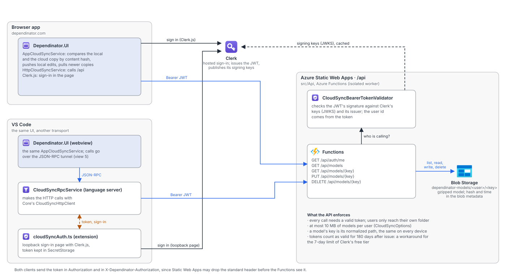
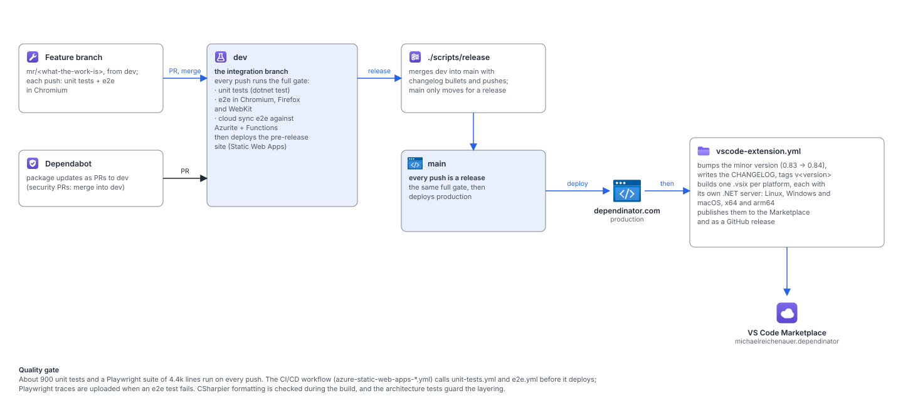

# Dependinator: architecture

An overview of how Dependinator is built, for the people who work on it and the people who plan
it. Seven views, each answering one question, drawn the way they would be discussed in an
architecture review: who uses the product, where the code runs, how the code is organized, how
source code becomes a picture, how the VS Code parts talk, how cloud sync and sign-in work, and how
a change reaches users. The code is the source of truth; the diagrams are generated from a small
script and are meant to be updated with it (see the end of this page).

## The product at a glance

Dependinator draws a codebase as a zoomable map. A C# solution or an Azure Bicep deployment is
parsed into nodes (projects, namespaces, types, members, or modules and resources) and the links
between them, laid out automatically, and drawn so that zooming in opens a node to show its inside.
Users explore dependencies, find cycles, check architecture rules, jump to the code, and add their
own notes, icons and hand-drawn nodes on top.

| | |
|---|---|
| **Shipped as** | A VS Code extension on the Marketplace (the product), and a web app at [dependinator.com](https://dependinator.com) for trying it out and for viewing synced models |
| **Languages it reads** | C# (`.sln` with C# projects, through Roslyn) and Azure Bicep (an entry `.bicep` file and its local modules, through the Bicep compiler) |
| **Stack** | .NET 10 (built with the .NET 11 preview SDK for C# 15 unions), Blazor WebAssembly and Blazor Server, MudBlazor, StreamJsonRpc, OmniSharp LSP, TypeScript for the extension, Azure Static Web Apps, Azure Functions and Blob Storage, Clerk for sign-in |
| **Size** | About 41k lines of product code, 70% of it in the shared UI library; about 25k lines of tests |
| **Tests** | About 900 unit tests, a Playwright UI suite run in Chromium, Firefox and WebKit, and architecture tests that guard the layering |
| **Releases** | Version 0.83 (beta). Every push to `main` is a release; there have been about 30 since July 2026 |

## 1. Context view: who uses Dependinator, and what it talks to

There are three ways in. **Developers** install the VS Code extension, open a folder with a `.sln`
or a Bicep deployment, and run *Dependinator: Open*; this is the product. **Evaluators** open
dependinator.com in a browser, where the built-in demo models (this repository and the webshop
Bicep example) open without installing anything, and where they can sketch design models by hand
and open models synced from VS Code. **Contributors** run the Blazor Server dev host, which parses
this repository and is also the app the e2e tests drive.

Only three external services are involved, and all are optional for the core use: **Clerk** signs
users in for cloud sync, the small **cloud sync API** (our own Azure Functions over Blob Storage)
stores the synced models, and the **Anthropic Claude API** reviews a circular dependency when the
user asks, with the user's own API key.

Points to discuss: source code never leaves the machine through sync, only the drawn model does,
but the Claude review sends code excerpts of the cycle it asks about. The web app cannot parse
code, so its value to a new user depends on the demo models and on sync.

## 2. Hosts view: one UI, three hosts

The whole user interface is one Razor class library, `Dependinator.UI`, and it runs unchanged in
three hosts.

In **VS Code** the TypeScript extension opens a webview that loads the **Blazor WebAssembly** build
(`Dependinator.Wasm`), and starts a **language server** (`Dependinator.Lsp`), a self-contained .NET
executable bundled per platform, which hosts the parsers. The UI cannot read files or run Roslyn
inside a webview, so it calls the parser through an RPC proxy and the call is carried to the
server (view 5). Models are cached in the webview's IndexedDB.

On **dependinator.com** the same WebAssembly build is served by Azure Static Web Apps. There is no
parser in the browser: the two demo models were parsed at build time by `Dependinator.DemoGen` and
are downloaded as gzipped files. The site's `/api` routes go to `src/Api`, the Functions app for
cloud sync. `main` deploys production and `dev` a pre-release site.

The **Blazor Server** host (`Dependinator.Web`) runs the UI on the server and the parsers in the
same process, so a contributor gets hot reload and real parsing of this repository with one
command (`./scripts/watch`). With `./scripts/e2e -s` a local Functions host and Azurite stand in
for the cloud.

Points to discuss: the browser and VS Code builds are the same binary, which keeps behavior aligned
but means UI work is always tested in WebAssembly, the slowest of the three (layout budgets are
measured there). Parsing C# needs an installed .NET SDK on the user's machine, because Roslyn loads
projects with the SDK's MSBuild; the README currently says no local `dotnet` is needed, which holds
for Bicep only.

## 3. Code structure view: projects, layers and the rules that guard them

References point one way: **hosts → UI → Core → Shared**, with the parser libraries (**Roslyn**,
**Bicep**) and the **Claude** integration plugging into Core. Hosts are thin (a few hundred lines
each): they register services and start. `Dependinator.Core` is host-agnostic: the parsing
contracts (`IParserService`, `ISourceParser`, the `Item` types), the JSON-RPC transport, the cloud
sync HTTP client, workspace and model-path services, and the `Result`/`Error` types every fallible
call returns. `Shared` holds the few DTOs that the API and the client both use.

`Dependinator.UI` is where most of the product lives (about 29k lines): `Modeling/` owns the
in-memory model, the automatic layout and the undoable commands; `Diagrams/` renders and handles
interaction, and holds the analysis features; `App/` is the shell; `Shared/` holds the
cross-cutting services. Adding a language means adding a library with an `ISourceParser`,
registering it in the Lsp and Web hosts, and adding an architecture rule; nothing else changes.

`Dependinator.Architecture.Tests` turns the layering into failing tests (NetArchTest), so a
reference in the wrong direction breaks the build in CI rather than surfacing in a review.

Points to discuss: `Dependinator.UI` is large and growing; `Diagrams/` alone mixes rendering,
interaction and five analysis features, and could be split into libraries if it keeps growing.
`Dependinator.Reflection` (2.5k lines, plus tests) is kept but not used by any host.

## 4. Runtime view: from source code to a picture on the screen

**Parse.** `ParserService` hands the model path to the first parser whose `CanParse` matches:
Roslyn opens the solution with `MSBuildWorkspace` and walks each project's compilation; the Bicep
parser compiles the entry file with its local modules and walks the semantic model; the demo paths
load a pre-parsed file. Every parser returns the same thing, a flat list of **items**: nodes named
by dotted paths (`Dependinator.Core.Parsing.ParserService`), links between names, optional line
descriptions, and parse problems such as compile errors. This list is the only contract between
parsing and the rest, and the call is an `[Rpc]` interface, so it crosses a process boundary in VS
Code and is a plain call elsewhere.

**Model.** `ModelService` first opens the cached model, so a known model appears instantly, then
parses and merges the items in batches of 100. `StructureService` builds the node tree from the
names, adds links and the line "funnels" that aggregate many links into one line between siblings,
and removes what a new parse no longer reports. The model, with the user's layout, notes, rules and
accepted cycles, is saved as a `ModelDto` to IndexedDB shortly after each change, and optionally
synced.

**Render.** Nothing is laid out up front. A container is laid out (layered, few crossings) the
first time it opens on screen, and large containers are refined in the background when the user is
idle. `RepLineService` decides which lines exist at the current zoom, `SvgService` renders the
visible area as SVG tiles that are cached, and the `Canvas` component shows them and turns pointer
events into gestures. This lazy, tiled design is what keeps large solutions responsive in
WebAssembly.

The features that make the map useful read the same model: the dependency explorer, cycle
detection (strongly connected components among siblings, with "accept" or "fix later"),
architecture rules, the path finder ("why does A depend on B?"), the problem indicator, search and
share links. Every edit goes through `CommandService`, so it can be undone, and is saved.

Points to discuss: the cache-first load means a model can show a stale state for the seconds a
re-parse takes; the problem indicator reports when that parse finds compile errors. All model
state is guarded by one lock per session, which keeps rendering and parsing consistent but is a
known place to look first for UI stalls.

## 5. VS Code integration view: how the webview, the extension and the server talk

The UI and the language server talk **JSON-RPC end to end**, with the extension host only relaying
strings. In the webview, a UI service calls an `[Rpc]` interface such as `IParserService`;
`JsonRpcService` (StreamJsonRpc) serializes the call, gzips payloads from 64 KB, splits messages
into chunks of at most 1 MB and base64-encodes them; the webview posts them to the extension as
`lsp/message`, the extension forwards them as LSP notifications over stdio, and the server's own
`JsonRpcService` dispatches them to the real implementation. Answers travel back as `ui/message`.
The extension holds messages until the server reports `ui/lspReady`, and restarts a crashed server.

Next to the tunnel there are a few plain messages between the UI and the extension: open the
editor at a node's source, show the node for the file the user switched to, refresh after source
files changed, open search, report parsing status for the status bar. Secrets stay in the
extension: the Clerk token and the Claude key live in VS Code's secret storage, and the server asks
for them per request.

Points to discuss: the same `[Rpc]` interface works in process (dev host, browser) and across the
tunnel, which keeps one code path, but anything a parser reads from statics or configuration does
nothing in VS Code; per-model settings must travel as method arguments. The web-only flavor of the
extension (vscode.dev) cannot start the server and therefore cannot parse.

## 6. Cloud sync and identity view

Sync is optional and per user. Users sign in with **Clerk**: in the browser app with Clerk.js on the
page; in VS Code through a sign-in page the extension serves on a loopback port, after which it
keeps the token in secret storage. `AppCloudSyncService` in the UI compares the local and the cloud
copy of the open model by content hash, pushes local edits and pulls newer copies, in the
background while the user works. In the browser it calls `/api` directly; in VS Code the call goes
through the tunnel to the language server, which makes the HTTP request with the stored token.

The **API** is five small Functions. Each request's JWT is validated against Clerk's published
signing keys and issuer, and the user id in the token decides the folder in Blob Storage the call
can touch. Models are stored gzipped, with their hash and update time as blob metadata, at most
10 MB per user. A model's key is its normalized path, so the same model has the same key on every
device; share links use that key.

Points to discuss: tokens are accepted for 180 days after they were issued instead of until their
own expiry, a workaround for the 7-day limit of Clerk's free tier that should go once a paid plan
allows longer lifetimes. Both clients send the token in a custom header as well as in
`Authorization`, because Static Web Apps may drop the standard header.

## 7. Delivery view: from a commit to production and the Marketplace

Work happens on `mr/...` feature branches from `dev`; each push runs the unit tests and the e2e
suite in Chromium. `dev` is the integration branch: every push there runs the full gate (unit
tests, e2e in Chromium, Firefox and WebKit, and the cloud sync e2e tests against Azurite and a
local Functions host) and then deploys the pre-release site. Dependabot sends package updates to
`dev`.

A release is one command: `./scripts/release` merges `dev` into `main` with changelog bullets.
Every push to `main` runs the same gate, deploys dependinator.com, and then runs the extension
workflow, which bumps the minor version, tags it, builds one `.vsix` per platform (Linux, Windows
and macOS, each for x64 and arm64, each with its own self-contained server), and publishes them to
the VS Code Marketplace and a GitHub release.

Points to discuss: the full gate runs on every `dev` push, which keeps `main` always releasable at
the cost of CI time. The demo models and the demo gif are generated from the code and checked in,
so they need regenerating when the parser or the UI changes visibly.

## Key design decisions

| Decision | Why | What it costs |
|---|---|---|
| One Blazor UI for every host | One implementation of a large, interactive UI for VS Code, the web and development | WebAssembly sets the performance budget for everything |
| Parsers behind an `[Rpc]` interface | The parser runs where the files and the SDK are (the language server), the UI stays the same | Settings must travel as arguments; calls can fail like network calls |
| A flat item list as the parser contract | New languages (Bicep was added in one release) only produce items; layout, rendering and analysis come for free | Language-specific meaning has to fit nodes, links and a few properties |
| Lazy layout and tiled SVG rendering | Large solutions stay responsive; only what is on screen is computed | More moving parts: layout versions, refinement, tile cache budgets |
| Local-first models with optional sync | Works offline and without an account; nothing leaves the machine by default | Two copies to reconcile when sync is on |
| `Result` / `Error` unions instead of exceptions | Failures are visible in signatures and must be handled (the build fails on a missing case) | Needs the .NET 11 preview SDK until it ships |
| Architecture rules as tests | The layering stays true without relying on review | A new project needs a new rule |

## Where to start reading the code

| To understand | Start at |
|---|---|
| How a model is loaded, parsed and saved | `src/Dependinator.UI/Modeling/ModelService.cs` |
| What parsers return | `src/Dependinator.Core/Parsing/Types.cs`, `ParserService.cs` |
| C# parsing | `src/Dependinator.Roslyn/Parsing/SourceParser.cs` |
| Bicep parsing | `src/Dependinator.Bicep/Parsing/BicepParser.cs`, `ModelBuilder.cs`, and [docs/notes/BICEP-PARSER.md](notes/BICEP-PARSER.md) |
| The in-memory model | `src/Dependinator.UI/Modeling/Models/Model.cs`, `Node.cs` |
| Rendering and zoom | `src/Dependinator.UI/Diagrams/Svg/SvgService.cs`, `RepLineService.cs`, `NodeViewPolicy.cs` |
| Layout | `src/Dependinator.UI/Modeling/NodeLayout.cs`, `Layout/LayeredEngine.cs` |
| The VS Code bridge | `src/DependinatorVsCode/src/extension.ts`, `src/Dependinator.Lsp/LspMessageHandler.cs`, `src/Dependinator.Core/Rpc/` |
| Cloud sync | `src/Dependinator.UI/Shared/CloudSync/AppCloudSyncService.cs`, `src/Api/ModelFunctions.cs` |
| Hosts and service wiring | each host's `Program.cs` |
| Conventions, commands and traps | [CLAUDE.md](../CLAUDE.md), [CONTRIBUTING.md](../CONTRIBUTING.md), `.claude/rules/` |

## Risks and open topics

- **Preview SDK.** The build needs the .NET 11 preview SDK for C# 15 unions; the move to the GA SDK
  is planned in [docs/notes/NET11-UPGRADE.md](notes/NET11-UPGRADE.md).
- **C# parsing needs a .NET SDK on the user's machine**, while the README says no local `dotnet` is
  needed; the requirement holds for Bicep only.
- **Clerk free tier.** The 180-day token workaround (view 6) trades some security for convenience.
- **Concentration in one library.** 70% of the product code is in `Dependinator.UI`.
- **Inactive code.** `Dependinator.Reflection` is maintained but unused.
- **Known parser gaps** are listed in `.claude/rules/parsing.md` (for example, generic type
  arguments do not produce links yet).

## Regenerating the diagrams

The SVGs are generated by [architecture/generate.py](architecture/generate.py), the same approach
as the [webshop example's diagrams](../examples/bicep/ARCHITECTURE.md): icons from Dependinator's own
icon library (`src/Dependinator.UI/Diagrams/Icons/Library`), cards, groups and labeled edges placed
by hand, so they stay consistent and can be edited as text. Run it with Python 3 after changing the
architecture, and check the result in a browser; the files render standalone and inside this page.
