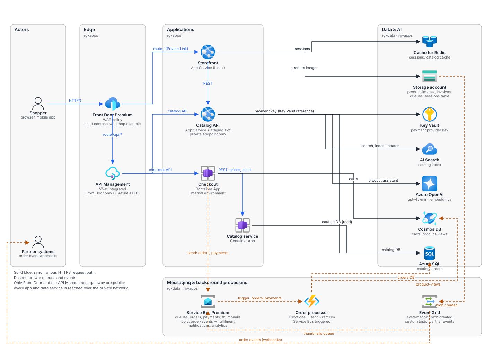
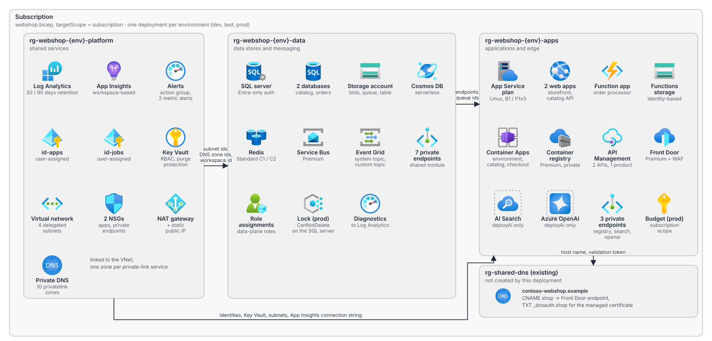
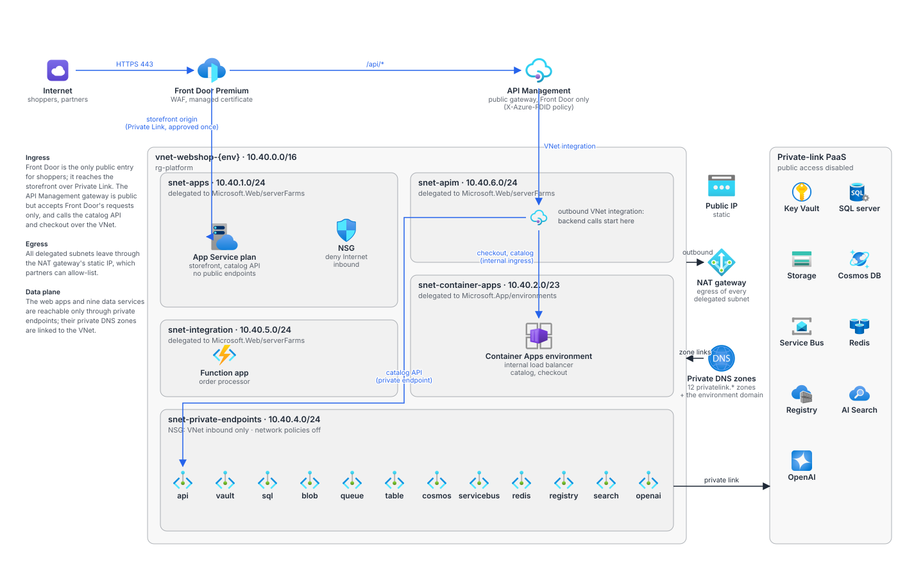
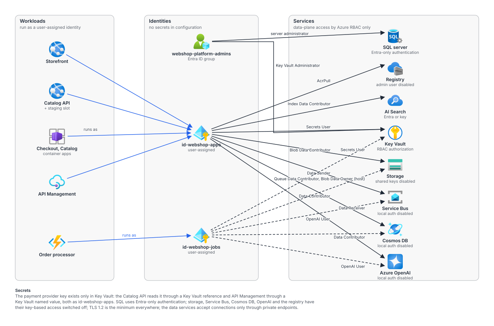

# Webshop platform: architecture

Four views of the fictional webshop deployment in this folder, drawn the way they would be
discussed in an architecture review. Each view answers one question; the Bicep files are the
source of truth, and the diagrams are regenerated from a small script when the deployment changes
(see the end of this page).

## 1. Runtime view: how a request and an order move through the system

Shoppers reach **Front Door Premium** (WAF, managed certificate on `shop.contoso-webshop.example`).
Front Door serves the storefront over a Private Link origin and sends everything under `/api/*` to
**API Management**, a VNet-integrated gateway that accepts Front Door's requests only and publishes
the catalog API (an App Service web app behind a private endpoint) and the checkout API (a Container
App in an internal environment).
Checkout calls the internal catalog service for prices and stock, keeps carts in **Cosmos DB** and
hands orders and payments to **Service Bus** queues. The **order processor** (Functions, Elastic
Premium) is triggered by those queues and writes the orders database and product-view events.
Product-image uploads raise **Event Grid** events that queue thumbnail jobs, and a custom topic
publishes order events to partners. The catalog API uses SQL, Redis, storage, **AI Search** and
**Azure OpenAI** (the product assistant), and reads the payment provider key through a Key Vault
reference.

Points to discuss: the storefront talks to the catalog API directly over the VNet (not through API
Management); the order processor is the only writer of the orders database; thumbnails and partner
events are fire-and-forget through Event Grid.

## 2. Deployment view: what one deployment creates, and where

`webshop.bicep` runs at subscription scope and creates three resource groups per environment.
**Platform** holds what every other part depends on: Log Analytics and Application Insights, the two
user-assigned identities, Key Vault, the virtual network with its five delegated subnets, NSGs and NAT
gateway, and the twelve private DNS zones. **Data** holds the stores and messaging plus their private endpoints; in production
the SQL server carries a delete lock. **Apps** holds the compute and the edge (the catalog API's private endpoint, the internal Container
Apps environment with its own DNS zone, the VNet-integrated API Management gateway and its Front
Door-only policy), with the AI services present only when `deployAi` is set. Records for the shop host name are written into a DNS zone that
already exists in a shared resource group. Module outputs flow left to right: subnet and DNS zone ids
and the workspace id into the data modules, service endpoints into the apps, and the Front Door host
name and domain-validation token into DNS.

Points to discuss: one subscription-scope deployment versus one per resource group; whether the
shared DNS zone should stay outside this template; the production-only budget and lock.

## 3. Network view: who can reach what

The virtual network (`10.40.0.0/16`) has five delegated subnets: App Service and Functions use
regional VNet integration from `snet-apps` and `snet-integration`, API Management (Standard v2 or
Premium v2) integrates outbound through `snet-apim`, the Container Apps environment owns
`snet-container-apps` (a /23, as the platform requires) as an internal environment, and
`snet-private-endpoints` holds the private endpoints of the catalog API and the nine data services.
All of those have public network access disabled and resolve through private DNS zones linked to the
network; the environment's default domain gets its own zone. Nothing but Front Door and the API
Management gateway is reachable from the Internet: Front Door uses a Private Link origin for the
storefront, and API Management only honours requests that carry this Front Door's id. Outbound
traffic from every delegated subnet leaves through the NAT gateway's static public IP, which
partners can allow-list.

Points to discuss: Front Door's private endpoint connection on the storefront must be approved once
after the first deployment (portal or a pipeline step), or the origin stays unhealthy. VNet
integration needs a v2 API Management tier, which rules out the cheaper Developer tier for test
environments. With the Container Apps environment internal, developers need a VNet path (Bastion or
VPN) to call the apps directly.

## 4. Identity and security view: who is allowed to do what

Two user-assigned identities carry all data-plane access. `id-webshop-apps` runs the storefront, the
catalog API, both container apps and API Management; `id-webshop-jobs` runs the order processor. Each
holds only the roles its workloads need (Secrets User on Key Vault, Blob or Queue Data Contributor on
storage, Sender or Receiver on Service Bus, Data Contributor on Cosmos DB, AcrPull, Search index and
OpenAI roles). An Entra group administers the SQL server (Entra-only authentication) and Key Vault.
Key-based access is switched off everywhere it can be: storage shared keys, Service Bus, Cosmos DB,
OpenAI and registry local auth. The payment provider key lives only in Key Vault and reaches the
catalog API through a Key Vault reference and API Management through a Key Vault named value.

Points to discuss: both identities hold Cosmos DB Data Contributor on the whole account; a split per
database would tighten it. AI Search still accepts API keys next to Entra ID.

## Regenerating the diagrams

The SVGs are generated by a script that composes the official Azure icons from Dependinator's icon
library (`src/Dependinator.UI/Diagrams/Icons/Library`) with hand-placed nodes and labeled edges, so
they stay consistent and can be edited as text. The generator lives next to the diagrams as
[architecture/generate.py](architecture/generate.py); run it with Python 3 from the repository root
after changing the deployment, and check the result in a browser (the files render standalone and
inside the READMEs).
