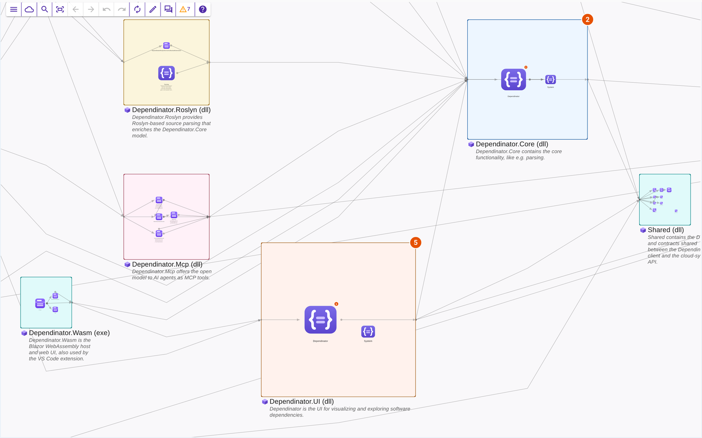
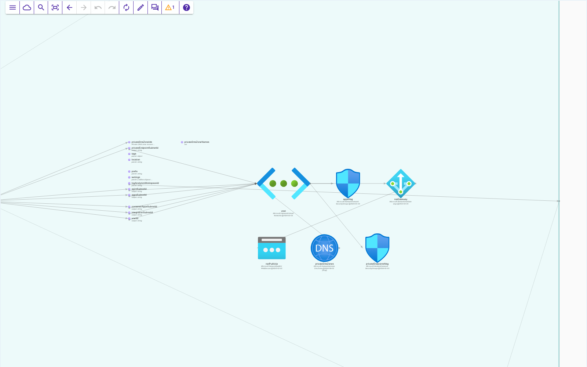
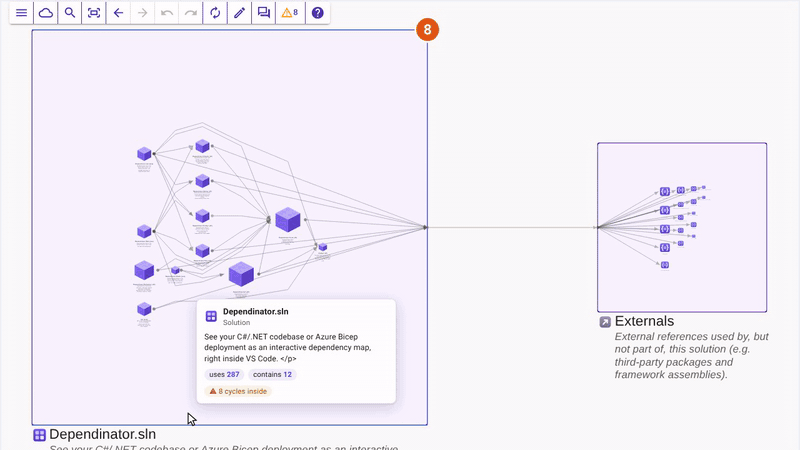

# Dependinator

See your C#/.NET codebase or Azure Bicep deployment as an interactive dependency map, right inside VS Code.
Dependinator parses your solution and draws it as a zoomable map: projects,
namespaces, types and members are nested nodes, dependencies are the lines
between them. A Bicep deployment is drawn the same way: modules and resources
with their Azure icons, parameters and outputs, and the dependencies between them. Zoom out for the big picture, zoom in to see how a component works
inside, and jump from any node straight to its source.

Dependinator is in beta: the core works end to end, but expect rough edges and
the occasional breaking change between versions. Feedback shapes what gets built
next, so please [report bugs and ideas](https://github.com/michael-reichenauer/Dependinator/issues/new/choose).

## Why

- **Get oriented fast.** Joining a project or opening an old codebase? See how
  it is put together before reading a single file.
- **Refactor with confidence.** Find the tangles, see what depends on what, and
  check that a change lands where you expect.
- **Keep an architecture picture that stays true.** The map is generated from
  the code and refreshes as you edit. Annotate it with notes, icons and
  hand-drawn nodes, and it still reflects reality tomorrow.

## Features

- **Interactive map.** Pan, zoom and double-click to drill into any node. The
  breadcrumb and search (`Ctrl+F`) take you anywhere in one step. Lines are
  drawn soft until you select or hover a node, so busy diagrams stay readable.
- **C# and Bicep.** .NET solutions are parsed with Roslyn, Azure Bicep
  deployments with the Bicep compiler; resources carry their Azure icons, local
  modules expand in place, and existing resources show as externals.
- **TypeScript and JavaScript (new).** A project (a `tsconfig.json`, a
  `jsconfig.json`, or a `package.json` for plain JavaScript) is drawn as its
  folders and files, with classes and interfaces inside and each file's
  functions as rows; the TypeScript compiler resolves what uses what, across
  imports and out to the packages.
- **Types as UML cards.** Zoom into a type and it opens into a card with its
  fields, constructors, properties and methods, their signatures and comments,
  a padlock on private members, and a line from each member that has
  dependencies. Hover any node or line for a card with its description and
  dependency counts.
- **Dependencies explorer.** Pick a node and browse everything it uses and
  everything that uses it, down to member level.
- **Jump to code.** Open the source of a node or dependency in the editor. The
  map can also follow the file you are editing.
- **Automatic refresh.** The map updates when source files change (configurable).
- **Edit mode.** Arrange nodes, pick icons and colors, add notes, draw your own
  nodes and links, or sketch an architecture from an empty model. Every edit can
  be undone.
- **Icon library** with curated Azure, AWS and Google Cloud service icons.
- **Light and dark themes**, a mini-map, a legend, and export of the diagram as
  an image. One **Settings** dialog holds the theme, layout density, line and
  badge options, and the AI.
- **AI help.** Ask questions about the model (the nodes in the answer link to
  the diagram), take an AI-planned tour of the codebase's key parts (Help › Tour
  This Codebase), have a dependency cycle or a broken architecture rule reviewed,
  get rules suggested, and let Claude Code or Copilot improve comments or make a
  fix. Pick the AI once in Settings › AI: **Copilot** (or another language model
  VS Code offers) with your Copilot plan, Claude with your own Anthropic API key,
  Claude Code on your computer with your Claude login (experimental), or any AI
  chat by copying the prompt and pasting the answer back. Copilot makes fixes in
  Copilot Chat's agent mode, where you keep or undo each edit.
- **AI agents can ask about the map.** A local MCP server lets Copilot's agent
  mode (and Claude Code, after *Dependinator: Connect Claude Code*) look up
  nodes, dependencies, paths, cycles and architecture rules of the open diagram.
- **Multiple models** per workspace, with optional sync across devices and the
  companion web app at [dependinator.com](https://dependinator.com). With more
  than one solution, deployment or project in the workspace, a model of the
  **whole workspace** shows the ones you tick side by side in one diagram.

## Requirements

- A workspace containing a **.NET solution (`.sln`)** with C# projects, an
  **Azure Bicep deployment** (a `.bicep` entry file and its local modules), or a
  **TypeScript or JavaScript project** (a `tsconfig.json`, `jsconfig.json` or
  `package.json`). Dependinator parses it to build the dependency map.
- For C#, a [.NET SDK](https://dotnet.microsoft.com/download) that can build the
  solution, since Roslyn loads the projects with the SDK's MSBuild. Bicep needs no
  local `dotnet` or `bicep` installation; the extension bundles a self-contained
  language server with the Bicep compiler. TypeScript and JavaScript need nothing
  installed either: the parser runs on VS Code's own Node.js runtime (run
  `npm install` in the project, so its packages resolve).

## Getting started

1. Install the extension and open a folder containing a `.sln` or `.bicep` file.
2. Open the command palette (`Ctrl+Shift+P` / `Cmd+Shift+P`) and run
   **Dependinator: Open**, or click the Dependinator icon
   
   in the editor title bar.
3. The dependency map opens in a new tab. Zoom into nodes (or double-click
   one) to drill in, drag to pan, and press `Ctrl+F` to find a node by name.

The **Help** button in the Dependinator app bar opens the
[user guide](https://dependinator.com/help) with detailed usage instructions,
navigation tips, and keyboard/mouse controls.

## Commands

| Command | Description |
| --- | --- |
| `Dependinator: Open` | Open the Dependinator dependency map (also the icon in the editor title bar of C#, solution, Bicep, TypeScript and JavaScript files, and the status bar item). |
| `Dependinator: Reveal Current File in Diagram` | Show the node for the file at the cursor (`Ctrl+Alt+D`, `Cmd+Alt+D` on macOS; also in the editor's right-click menu). |
| `Dependinator: Search Nodes` | Open the diagram's node search. |
| `Dependinator: Re-parse Model` | Parse the solution, Bicep deployment or project again now. |
| `Dependinator: Set Claude API Key` | Store (or, left empty, remove) your own Anthropic API key, from console.anthropic.com, for the Claude route of the AI features (you are also asked for it on first use). It is kept in VS Code's secret storage and sent only to Anthropic. |
| `Dependinator: Connect Claude Code` | Add Dependinator's MCP server to Claude Code for this folder (`claude mcp add`, local scope), so Claude Code can ask about the open diagram. Copilot finds the server without this. |
| `Dependinator: Install in Dev Container` | Jump to the Extensions view to install the extension inside a dev container. |

## Settings

| Setting | Description |
| --- | --- |
| `dependinator.followActiveEditor` | Show the node for the file you switch to, so the diagram follows your work (default: `true`). |
| `dependinator.autoRefresh.enabled` | Automatically refresh the diagram when workspace source files change (default: `true`). When off, a dot on the Re-parse button shows that the source has changed. |
| `dependinator.autoRefresh.delaySeconds` | Delay after the last source file change before the diagram is refreshed (default: `3`). |

## Device sync and the web app

Device sync is optional. When you enable it (from the Dependinator app bar),
your models and customized views are kept updated on all devices that have
sync enabled. Without signing in, everything works locally.

The companion web app at [dependinator.com](https://dependinator.com) lets
you view your models outside VS Code, in a desktop or mobile browser,
wherever you are. Enable device sync with the same account in both the
extension and the web app, and the models you create in VS Code are there
too. Editing in the web app works as well, though viewing is its primary
use case; parsing code and creating models is what the extension is for.

## Feedback and issues

Found a bug or have a feature request? Please
[open an issue](https://github.com/michael-reichenauer/Dependinator/issues/new/choose).
For a problem, include the Dependinator version and anything in the
"Dependinator" channel of the Output panel. Questions and ideas are welcome in
[Discussions](https://github.com/michael-reichenauer/Dependinator/discussions).

## Links

- Web app (view your models anywhere): https://dependinator.com
- User guide: https://dependinator.com/help
- Repository: https://github.com/michael-reichenauer/Dependinator
- Discussions: https://github.com/michael-reichenauer/Dependinator/discussions
- Contributing / building the extension: see [DEVELOPMENT.md](DEVELOPMENT.md)

## License

MIT, see [LICENSE](LICENSE).
